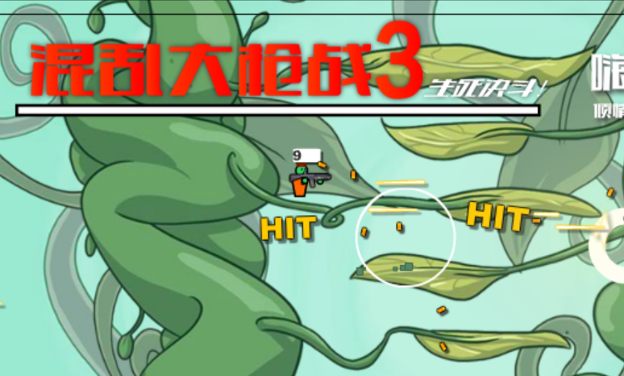

# pad2key

把手柄当键盘用：给**不支持手柄的老游戏**补一套按键桥接（单文件 PowerShell + SDL2，零安装）。

> A single-file PowerShell bridge that turns gamepad buttons into key presses for games that only understand a keyboard.

[](https://github.com/x18967890089-cell/pad2key/actions/workflows/ci.yml)

<p align="center"></p>

`-SelfTest` 的真实输出：不插手柄也能跑，确认 PowerShell 位数、SDL2 版本与连接状态都正常。

<p align="center"></p>

真机截图：《混乱大枪战3》（Adobe Flash Player 21）里用左摇杆走位、`X` 跳、`LB` 开火 —— 游戏本身只认键盘，中间没有任何插件或改包。

---

## 快速开始

前置条件：Windows + PowerShell 5.1 及以上（系统自带）+ 一个 SDL2 能识别的手柄。
不需要管理员权限，不需要安装任何东西。

### 1. 装 SDL2.dll

到 <https://libsdl.org> → Download → 下载 SDL2 的 Windows 发行包（`SDL2-2.x.y-win32-x64.zip`），
解压后把 **`SDL2.dll` 放到 `pad2key.ps1` 同一个目录**。

也可以放进任意一个 `PATH` 目录，脚本按「同目录 → PATH」的顺序查找，找不到会直接报错并给出下载地址。

> 位数要对齐：64 位 PowerShell 必须配 64 位的 `SDL2.dll`，装错会提示 `SDL2.dll could not be loaded`。

### 2. 自检（不需要游戏，也不需要手柄）

```powershell
powershell -NoProfile -ExecutionPolicy Bypass -File .\pad2key.ps1 -SelfTest
```

没插手柄时的实际输出：

```
pad2key self-test
  PowerShell : 5.1.26100.8115 (64-bit)
  SDL2 dir   : ...\pad2key  [next to pad2key.ps1]
  SDL2 build : SDL-release-2.32.10-0-g5d2495703
  joysticks  : 0
waiting for controller...
self-test finished, no keys were injected
```

插上手柄再跑一次，`joysticks` 会变成大于 0，并列出设备名与是否被识别为 game controller。
看到 `waiting for controller...` 就说明环境没问题，只差一个手柄。

### 3. 挂到游戏上

```powershell
# 按进程名（名字后面带不带 .exe 都行；把 flashplayer_21_sa 换成你自己的游戏进程名）
.\pad2key.ps1 -GameName flashplayer_21_sa

# 或按 PID —— 启动器拉起游戏时最可靠
$game = Start-Process .\game.exe -PassThru
.\pad2key.ps1 -GamePid $game.Id
```

不知道进程名：游戏开着的时候跑 `Get-Process | Where-Object MainWindowTitle | Select-Object Id,ProcessName,MainWindowTitle`。

`-GamePid` 和 `-GameName` 都不给会直接报错退出（不会去猜进程名）。
游戏退出后脚本自己结束；中途拔手柄会自动松开所有按键，插回来自动重连。

日志写在脚本同目录的 `pad2key.log`。

### 4. 按键没反应时按顺序查

1. **游戏窗口是不是在前台**——默认只在前台注入，Alt-Tab 出去会自动松开所有键，这是设计不是 bug。
2. **权限要对齐**——游戏用管理员权限跑的，脚本也必须用管理员权限跑，否则按键被 UIPI 拦掉（表现是自检正常、游戏里毫无反应）。
3. **自检里的 `joysticks` 是 0**——SDL2 没认出设备：换 USB 口 / 有线连接重试，装好手柄官方驱动，或换更新的 SDL2 版本。
4. **自检能列出手柄、游戏里还是没反应**——目标游戏多半用 Raw Input 或带反作弊，`keybd_event` 送进去的键它不认，这种情况目前无解。

四条都排完还是不行，带上 `-SelfTest` 的完整输出开 issue。

## 持续集成（在真实 Windows runner 上跑，不是「理论上能跑」）

每次 push 都会在 `windows-latest` 上真跑一遍，两个 job：

| job | 做什么 | 断言 |
|---|---|---|
| `parse + ascii + PSScriptAnalyzer` | Windows PowerShell 5.1 自带的 `Parser.ParseFile` 解析脚本；逐字节检查非 ASCII 字符数为 0；静态分析 | 0 个解析错误、纯 ASCII、`-Severity Error` 无输出 |
| `-SelfTest with a real SDL2.dll` | 先删掉 `SDL2.dll` 跑一次，再按 README 的方式去 libsdl.org 下载真实 DLL 放回同目录跑一次 | 缺 DLL 退 `3`；装好 DLL 后 `-SelfTest` 退 `0` 且输出含 `SDL2 dir` / `joysticks` / `self-test finished`；不带参数退 `2` |

最近一次全绿：run [42856802953](https://github.com/x18967890089-cell/pad2key/actions/runs/42856802953)。

两条踩过的坑写在这里，省得别人再踩：

- **`SDL2 build` 那行不一定有**。`SDL_GetRevision()` 返回空时脚本会跳过这一行（这正是设计：某些发行包不带 revision 字符串），所以 CI 不能把它当断言针，改断言 `SDL2 dir`。
- **断言「退出码应该是 3」的步骤末尾必须 `exit 0`**。`$LASTEXITCODE` 会漏到 step 退出码上，日志写着 `missing-dll exit code ok`、GitHub 仍判这一步失败。

## 在游戏里用（实测：《混乱大枪战3》）

老 Flash 游戏是最典型的「只认键盘」场景，整套流程四步：

```cmd
:: 1) 先起桥接（后台最小化），按进程名挂上去
start /min powershell -NoProfile -ExecutionPolicy Bypass -File pad2key.ps1 -GameName flashplayer_21_sa

:: 2) 再起游戏（顺序很重要：桥接会等 90 秒找进程，先起游戏也行）
start "" flashplayer_21_sa.exe Gun_Mayhem_3.swf

:: 3) 把游戏进程优先级提到 High，Flash 掉帧时按键不会排队
wmic process where "name='flashplayer_21_sa.exe'" CALL setpriority "128"
```

4. 点进游戏画面 → 左摇杆走位、`X` 跳、`A` 下蹲、`LB` 开火、`RB` 扔雷。

几个实测细节：

- **窗口标题不重要，进程名才重要**。Flash Player 的窗口标题是 `Adobe Flash Player 21`，进程名却是 `flashplayer_21_sa`，按 `-GameName` 挂要写进程名。
- **点一下游戏画面再按手柄**。Flash 的焦点没进 SWF 时按键会落在播放器外壳上，表现为「摇杆没反应」。
- **游戏切到后台就自动松开按键**，Alt-Tab 回来重新点一下画面即可。
- 手柄没插时脚本照样跑，插上自动重连，不用重启游戏。

## 键位配置

改键只改脚本顶部的 `# ---- config ----` 区，改完存盘重跑即可，不用重新安装。

| 手柄输入 | 默认按键 | vk 码 | 变量 |
|---|---|---|---|
| 左摇杆向左 | `A` | `0x41` | `$KEY_LEFT` |
| 左摇杆向右 | `D` | `0x44` | `$KEY_RIGHT` |
| `X` 键 | `W` | `0x57` | `$KEY_JUMP` |
| `A` 键 | `S` | `0x53` | `$KEY_CROUCH` |
| `LB` | `Z` | `0x5A` | `$KEY_FIRE` |
| `RB` | `X` | `0x58` | `$KEY_NADE` |

摇杆死区 `$DEAD = 8000`（轴范围 `-32768..32767`），超过即视为按下。

改成方向键的例子：

```powershell
$KEY_LEFT  = 0x25   # Left arrow
$KEY_RIGHT = 0x27   # Right arrow
```

vk 码表见 [Virtual-Key Codes](https://learn.microsoft.com/windows/win32/inputdev/virtual-key-codes)。

## 已知限制

- **只做键盘注入**（`keybd_event`）：用 Raw Input 独占或带反作弊的游戏可能收不到按键；目标游戏以管理员权限运行时，脚本也要以管理员权限运行，否则按键被 UIPI 拦掉。
- **只有左摇杆 X 轴 + 6 个按钮**，没有右摇杆、扳机、摇杆模拟量（推过死区就是全速），也没有组合键/宏。
- **默认只在游戏窗口处于前台时注入**，切走会立刻松开所有键。`-ForceOn` 可以关掉这层保护，但误触会打进别的窗口，一般不要用。
- **没有配置文件和多套键位**，换游戏就是改代码里的配置区。
- **仅 Windows**（`user32.dll` + `keybd_event`）。
- 手柄能不能认，取决于 SDL2 自带的映射库；`-SelfTest` 会打印设备名，认不出就换手柄或换更新的 SDL2。
- 在 Windows 11 x64 + PowerShell 5.1（`5.1.26100`）+ SDL2 2.32 上手测；CI 又在 `windows-latest`（PowerShell `5.1.26100.33648`）上复跑过自检，其它环境请开 issue。

退出码：`0` 正常结束 / `1` 90 秒内没找到游戏进程 / `2` 参数不全 / `3` 找不到 `SDL2.dll` / `4` SDL 初始化失败。

## 许可证

MIT © 2026 Reid — 见 [LICENSE](LICENSE)。
